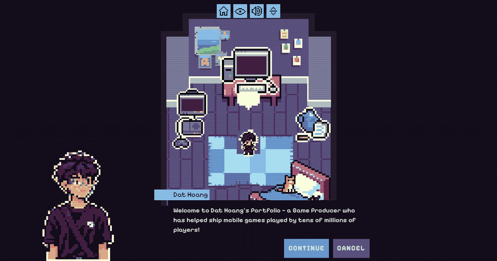

<div align="center">
  
  <h1>Hoang Dang Tuan Dat — Game Producer Portfolio</h1>
  <p><strong>A playable portfolio: walk around a pixel-art room, boot a retro OS, or browse my games on a console.</strong></p>

  <p>
    <a href="https://tuandat1811.github.io/myPortfolio/"><strong>▶ Play the portfolio</strong></a>
    &nbsp;·&nbsp;
    <a href="https://www.linkedin.com/in/tuandat0328/">LinkedIn</a>
    &nbsp;·&nbsp;
    <a href="mailto:dat.hdt181100@gmail.com">Email</a>
  </p>

  <p>
    
    
    
  </p>
</div>

## 👋 About Me

I'm **Hoang Dang Tuan Dat**, a Game Producer based in Hanoi, Vietnam (PMP certified).

| Project | Role | Highlights |
| :--- | :--- | :--- |
| **Lumber Inc** | Associate Game Producer @ NoPowerUp Studio | Idle tycoon, 70M+ downloads |
| **Milk Farm Tycoon** | Associate Game Producer @ NoPowerUp Studio | 500K+ downloads |
| **LEGO® Legacy: Heroes Unboxed** | Intern Game Producer @ Gameloft Hanoi | 50M+ downloads, released on Netflix Games |

Instead of a static CV, this site lets you *play* through my experience.

## 🗺️ Choose Your Journey

The start screen offers four ways to explore:

1.  **Full Experience** — Walk my pixel-art character around a room. Interact with the computer, the console and the desk to open each part of the portfolio, guided by visual-novel style dialogue.
2.  **Resume** — A paper-style resume page for a quick read.
3.  **Operating System** — A Windows 95-style desktop with draggable windows, a taskbar, and apps (Internet Explorer resume, PDF case studies, Notepad, Paint, Calculator, Messenger…).
4.  **Video Game** — A PlayStation 2-inspired memory card screen listing the games I've worked on, with links to play or watch them.

The whole site is available in **English** and **Tiếng Việt**, works offline as an installable PWA, and supports keyboard navigation and reduced motion.

## 🛠️ Tech Stack

| Category | Technology |
| :--- | :--- |
| Framework | React 19 + Vite |
| Language | TypeScript |
| State | XState + React Context |
| Styling | Tailwind CSS v4 (BEM-style class names) |
| i18n | i18next (`en`, `vi`) |
| Tests | Vitest + Testing Library |
| PWA / SEO | vite-plugin-pwa, react-helmet-async, JSON-LD |
| Hosting | GitHub Pages (GitHub Actions) |

## ✏️ Editing the Content

Most content is data-driven, so no React changes are needed:

| What | Where |
| :--- | :--- |
| Name, job title, email, LinkedIn, site URL | `frontend/src/data/profile.ts` |
| All UI text, bio, experience, education | `frontend/public/locales/en.json`, `vi.json` |
| Case studies (PDF viewer in the OS) | `frontend/src/content/projects/*-{en,vi}.md` |
| Game cards (Video Game journey) | `frontend/src/content/games/*-{en,vi}.md` |
| Player sprites, portrait, avatar | `frontend/src/assets/images/game/`, `frontend/src/assets/icons/` |
| Favicons and share image | `frontend/public/favicon_io/`, `frontend/public/banner.png` |

After editing translations, run `npm run i18n:validate` to check that both languages have the same keys.

**Pixel art guidelines:** draw at native resolution and export at **×5** with nearest-neighbour scaling (no smoothing), on a transparent background, as PNG plus WebP. The player sheets are 4 frames of 105×115 px (420×115 per sheet).

## 🚀 Getting Started

**Prerequisites:** Node.js 18+ and npm.

```bash
git clone https://github.com/tuandat1811/myPortfolio.git
cd myPortfolio/frontend
npm install
npm run dev
```

Open `http://localhost:5173`.

Other useful scripts (run inside `frontend/`):

| Command | Description |
| :--- | :--- |
| `npm run build` | Type-check and build to `dist/` |
| `npm run preview` | Serve the production build locally |
| `npm test` | Run the test suite |
| `npm run lint` | Lint the code |

## 🌐 Deployment

Every push to `main` triggers `.github/workflows/deploy-pages.yml`, which builds the site with `VITE_BASE=/<repo-name>/` and publishes it to GitHub Pages. The repository's **Settings → Pages → Source** must be set to **GitHub Actions**.

The `Dockerfile` (nginx) is still available for hosting at the domain root, where the base path defaults to `/`.

## 🙏 Credits & License

-   Based on [**PortfolioWebXP**](https://github.com/mewmewdevart/DevCommunityPortfolioChallenge2026) by Larissa Cristina ([mewmewdevart](https://github.com/mewmewdevart)), originally built for the DEV "New Year, New You" Portfolio Challenge. The OS, game engine and most of the pixel art are her work.
-   Background music: ["Chill (Loopable)"](https://opengameart.org/content/chill-loopable) by Alex McCulloch (Pro Sensory), CC0.

Distributed under the **MIT License**. See [`LICENSE`](./LICENSE).
